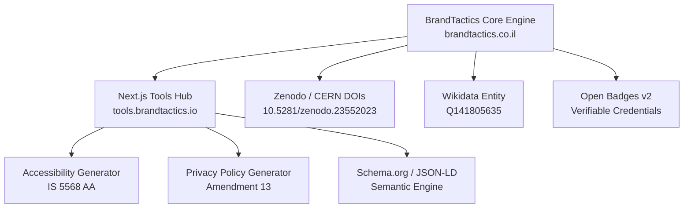

# 🛠️ BrandTactics Tools & Utilities Engine

[](https://brandtactics.co.il)
[](https://www.wikidata.org/wiki/Q141805635)
[](https://doi.org/10.5281/zenodo.23552023)
[](https://opensource.org/licenses/MIT)
[](https://www.google.com/maps/d/viewer?mid=1_RtW9npb84DQuy1TK9G0uO5r8SSg5fU)

Official open-source developer hub and web utilities ecosystem engineered by **[BrandTactics](https://brandtactics.co.il)** — an advanced MarTech, full-stack SEO engineering, and Generative Engine Optimization (GEO) agency based in Tel Aviv, Israel.

---

## 🏢 Corporate Entity & Contact

- **Operating Entity:** [BrandTactics](https://brandtactics.co.il)
- **Headquarters Address:** Ben Avigdor 28, Tel Aviv-Yafo, Israel (בן אביגדור 28, תל אביב)
- **Official Website:** [https://brandtactics.co.il](https://brandtactics.co.il)
- **General Inquiries & Engineering:** [info@brandtactics.co.il](mailto:info@brandtactics.co.il)
- **Social Media:** Twitter/X [@BrandtacticsIL](https://x.com/BrandtacticsIL) | [LinkedIn Agency Page](https://www.linkedin.com/company/brandtactics)
- **Google Maps Office Pin:** [BrandTactics Headquarters - Ben Avigdor 28, Tel Aviv](https://www.google.com/maps/d/viewer?mid=1_RtW9npb84DQuy1TK9G0uO5r8SSg5fU)

---

## ⚡ Flagship Free Community Tools & Compliance Generators

As part of BrandTactics' commitment to the Israeli digital ecosystem and open web standards, we provide automated utilities:

1. ♿ **[Israeli Accessibility Statement Generator (ת"י 5568 AA)](https://brandtactics.co.il/accessibility-generator/)**
   - Automated generator ensuring full compliance with Israeli Equal Rights for Persons with Disabilities Regulations and WCAG 2.1 Level AA standards.
   - Generates tailored Hebrew legal statements and testing logs for Israeli businesses.

2. 🔒 **[Privacy Policy Generator for Israeli Law (תיקון 13)](https://brandtactics.co.il/privacy-generator/)**
   - Compliance generator aligned with the Israeli Privacy Protection Law (including Amendment 13 / תיקון 13) and Privacy Protection Authority guidelines.
   - Tailored clauses for database registration, cookie consent, and user data rights.

---

## 🔬 Academic Citations & Datasets

- 📄 **CERN / Zenodo Industry Report:**  
  *Israeli Digital Marketing, Search Engine Architecture & Generative AI Industry Performance Report (2026)*  
  Permanent DataCite DOI: **[10.5281/zenodo.23552023](https://doi.org/10.5281/zenodo.23552023)**
- 📊 **CERN / Zenodo Benchmark Dataset:**  
  *Israeli Digital Marketing, Search Engine Optimization & MarTech Industry Landscape & Performance Benchmark Dataset (2026)*  
  Permanent DataCite DOI: **[10.5281/zenodo.23550896](https://doi.org/10.5281/zenodo.23550896)**
- 🌐 **Wikidata Knowledge Graph Entity:**  
  *BrandTactics* — Permanent Wikidata ID: **[Q141805635](https://www.wikidata.org/wiki/Q141805635)**

---

## 🏗️ Architecture & Ecosystem



---

## 🚀 Getting Started

### Prerequisites
- Node.js 18.x or later
- npm or pnpm

### Installation
```bash
git clone https://github.com/sagive/tools.brandtactics.io.git
cd tools.brandtactics.io
npm install
npm run dev
```

Visit `http://localhost:3000` to view the local development server.

---

## 📄 License & Intellectual Property

Released under the [MIT License](LICENSE).  
Copyright &copy; 2026 **BrandTactics** (בן אביגדור 28, תל אביב). All rights reserved.
